# Corde

**Télémétrie en direct, analyse des tours et ingénieur de course pour Le Mans Ultimate.**

Corde est une application Windows qui tourne à côté du jeu. Elle lit la télémétrie de Le Mans Ultimate,
l'affiche en direct dans un tableau de bord fait de widgets, enregistre chaque session, puis analyse ta
conduite et te propose des ajustements de réglage que tu affines avec ton ressenti. Tout reste sur ton PC :
pas de compte, pas de cloud.

Le nom vient du **point de corde** : l'endroit où la trajectoire idéale touche l'intérieur du virage, celui
que l'on vise à chaque tour. Corde s'appelait anciennement Muret (nom de travail).

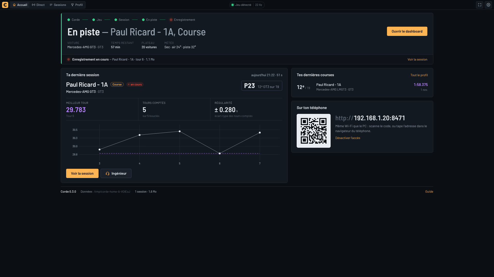

> **Version de test (novembre 2026).** Corde fonctionne avec le jeu réel, mais elle est jeune : certaines
> parties n'ont été vérifiées qu'avec le simulateur intégré, et l'installeur n'est pas encore signé
> (voir [Installer](#installer-windows)). Les captures de cette page viennent du simulateur intégré.

## Sommaire

- [Installer (Windows)](#installer-windows)
- [Ce que fait Corde](#ce-que-fait-corde)
  - [Le tableau de bord en direct](#le-tableau-de-bord-en-direct)
  - [Sur le téléphone](#sur-le-téléphone)
  - [Sessions et tours](#sessions-et-tours)
  - [Profil et résultats de course](#profil-et-résultats-de-course)
  - [L'ingénieur de course](#lingénieur-de-course)
- [Où en est le projet](#où-en-est-le-projet)
- [Pour les développeurs](#pour-les-développeurs)
- [Documentation](#documentation)
- [Licence](#licence)

## Installer (Windows)

1. Ouvre la page [Corde — dernière version](https://github.com/dultra123/corde/releases/tag/continuous) et télécharge
   `Corde_…_x64-setup.exe` (section *Assets*).
2. Lance-le. Windows affiche « Windows a protégé votre ordinateur » parce que l'installeur n'est pas signé :
   **Informations complémentaires**, puis **Exécuter quand même**. L'installation ne demande pas les droits
   administrateur.
3. Ouvre **Corde** depuis le menu Démarrer, puis lance Le Mans Ultimate (avec
   `Settings > Gameplay > Enable Plugins` activé). Corde détecte le jeu toute seule.

Le guide complet, avec le dépannage, est dans [docs/TESTING-ON-PC.md](docs/TESTING-ON-PC.md).

## Ce que fait Corde

### Le tableau de bord en direct

Le tableau de bord s'ouvre quand tu prends la piste. Dix widgets sont disponibles : tours et delta, commandes
(volant, pédales, régime), pneus (températures sur trois zones, pressions, usure), freins, carburant et
énergie, écarts, classement, carte du circuit, session et météo, électronique.

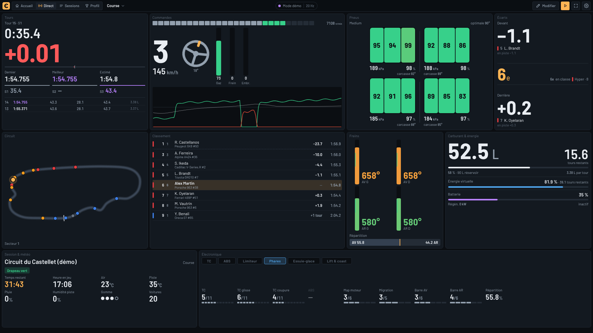

Chaque widget se déplace, s'étire et se supprime, et tu en ajoutes d'autres depuis la palette. Tu peux garder
plusieurs dispositions, par exemple une pour l'écran du PC et une pour le téléphone.

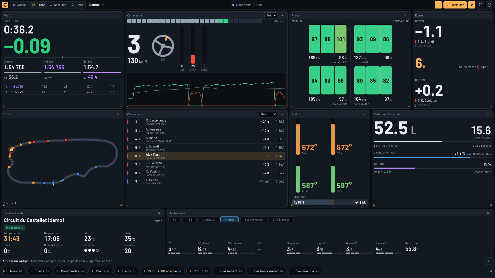

### Sur le téléphone

Les mêmes pages s'ouvrent dans le navigateur du téléphone, sur le même Wi-Fi que le PC. L'accès est fermé par
défaut ; il s'active d'un bouton sur l'écran d'accueil, qui affiche alors un QR code à scanner.

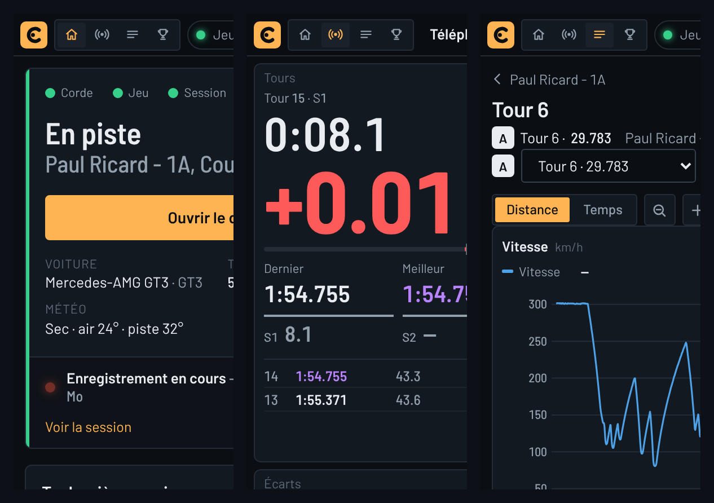

### Sessions et tours

Chaque session est enregistrée automatiquement. Les temps au tour sont ceux du jeu : un tour compte quand le
jeu l'a chronométré et qu'il ne passe pas par les stands.

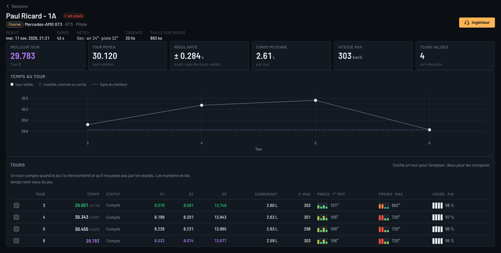

Tu peux ouvrir un tour, ou en comparer deux : écart de temps le long du tour, vitesse, gaz, frein, volant,
rapport et régime, accélérations, avec export CSV.

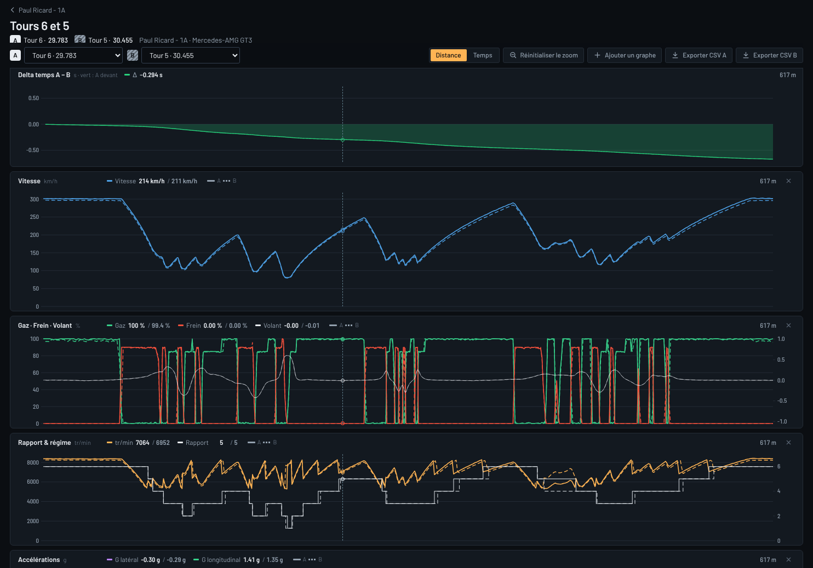

### Profil et résultats de course

Corde lit aussi les fichiers de résultats du jeu : classements, positions, incidents, et un profil qui
rassemble toutes tes courses par circuit et par voiture.

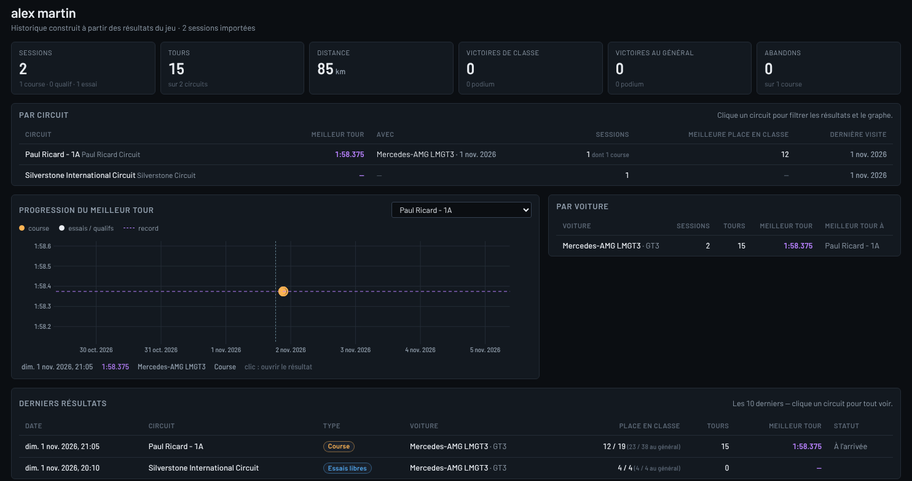

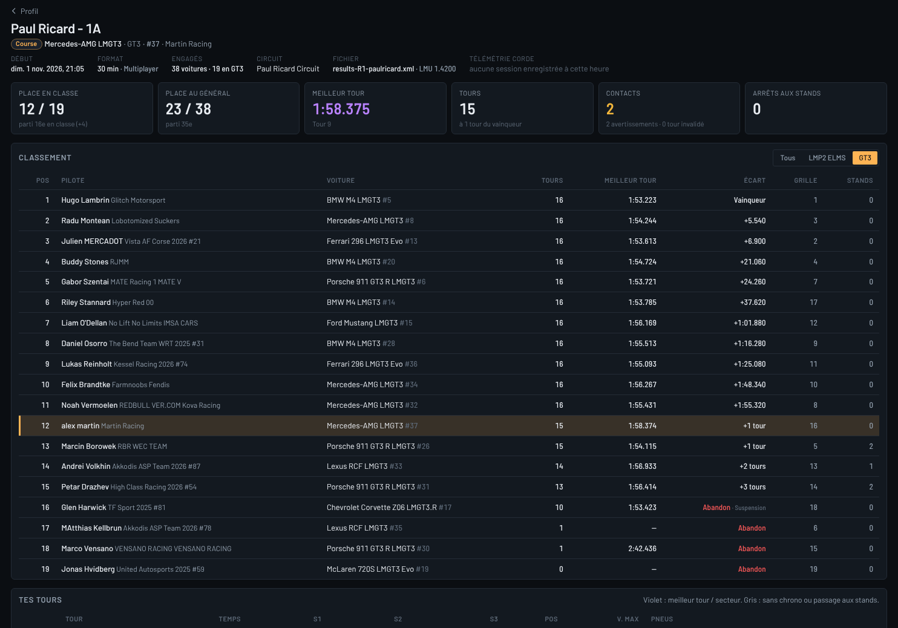

### L'ingénieur de course

Après une session d'au moins trois tours propres, l'ingénieur analyse tes données : régularité, style de
pilotage, températures et pressions des pneus, freins, équilibre de la voiture virage par virage, suspension.

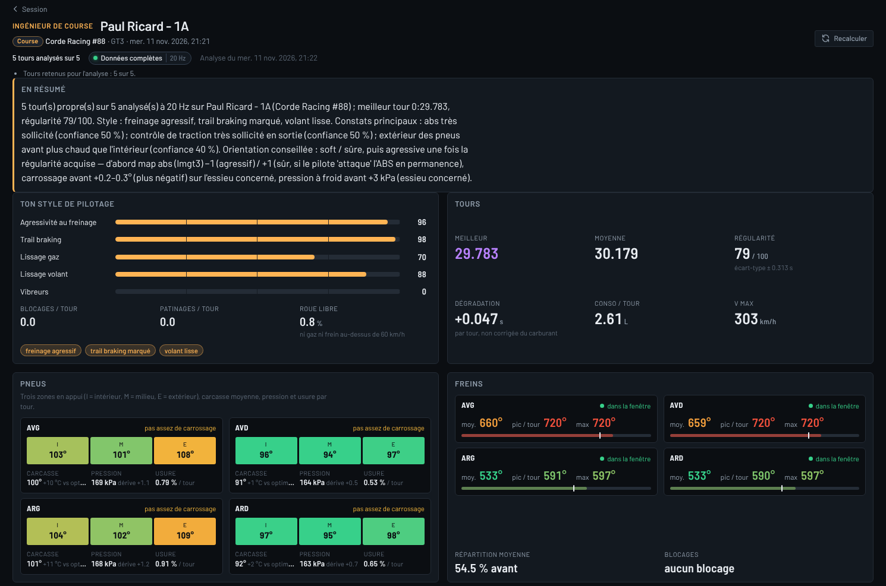

Il en tire des constats classés par gravité, chacun avec les chiffres qui le justifient.

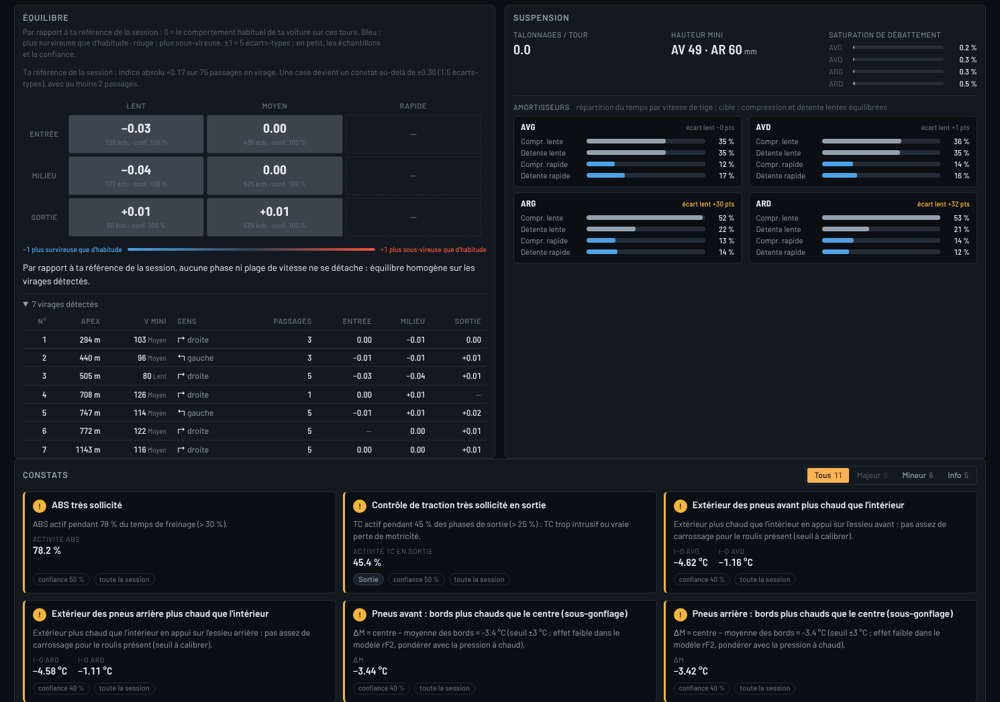

Il propose ensuite trois orientations de réglage — **agressif**, **soft et sûr**, **pluie** — sous forme de
changements ordonnés, avec la raison de chacun et ses effets secondaires.

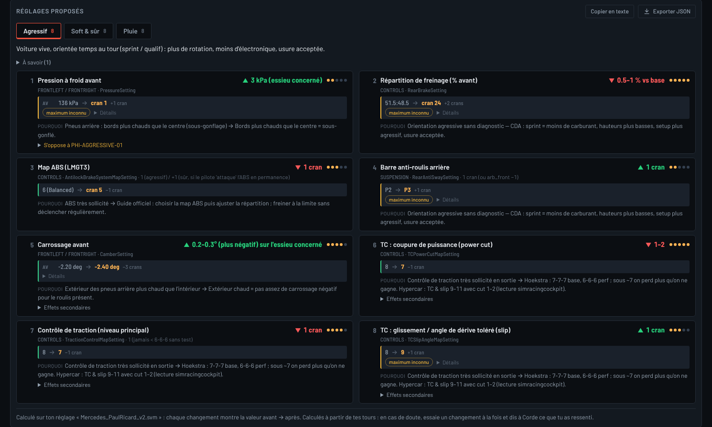

Tu en essaies un, puis tu écris ce que tu as ressenti, avec tes mots. Corde traduit ton ressenti en
symptômes, le compare aux données et propose deux ou trois petits changements pour l'étape suivante. Quand ton
ressenti et les données ne disent pas la même chose, elle te le signale.

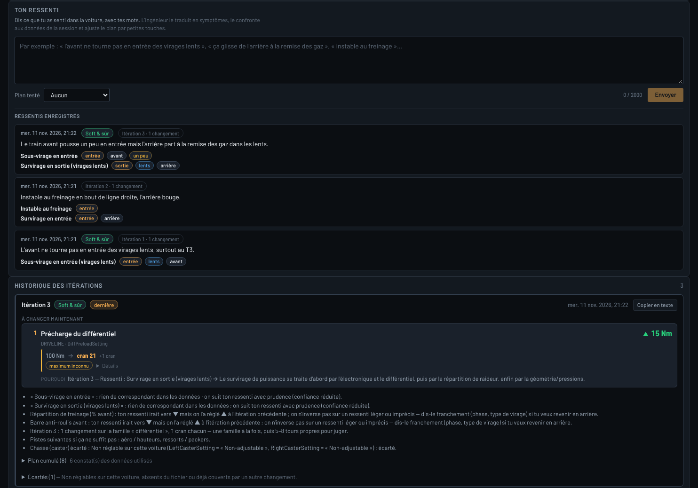

Corde lit tes propres fichiers de réglage (`.svm`, ceux que tu sauvegardes dans le garage du jeu), choisit
celui avec lequel tu as roulé et calcule chaque changement sur ce vrai réglage : valeur avant → après, en
crans du jeu, sans jamais proposer un réglage que ta voiture ne permet pas. D'un clic, elle écrit les fichiers
`Corde_…svm` à côté du tien ; dans le garage : Setups → rafraîchir → charger. Elle ne modifie ni n'écrase
jamais un fichier existant, et n'écrit rien d'autre dans le dossier du jeu.

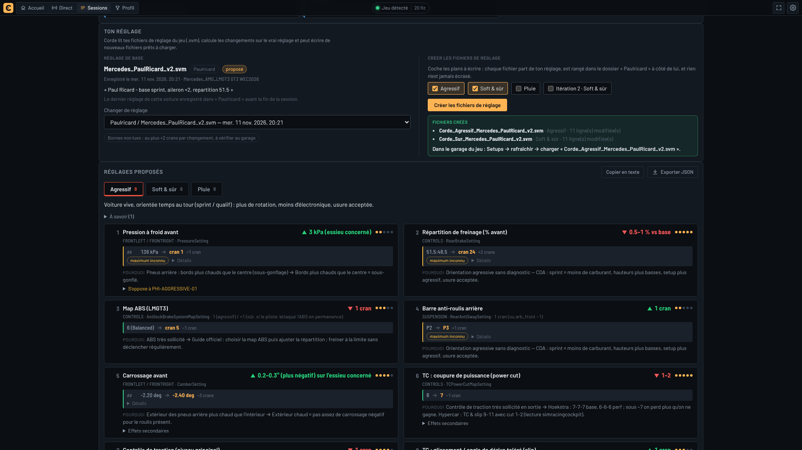

## Où en est le projet

| Partie | État |
|---|---|
| Lecture de la télémétrie de Le Mans Ultimate (Windows) | fait, testé avec le jeu |
| Application Windows : écran d'accueil, tableau de bord, icône de zone de notification | fait, premiers essais réels en cours |
| Enregistrement des sessions, temps officiels du jeu, comparaison de tours | fait, testé avec le jeu |
| Profil et résultats de course | fait |
| Ingénieur : analyse, trois orientations de réglage, ressenti → ajustement | fait, à calibrer sur des données réelles |
| Fichiers de réglage `.svm` prêts à charger dans le jeu | fait (lecture de tes réglages, crans réels, écriture à la demande) ; bornes exactes à lire dans le garage du jeu sur ton PC |
| Page des courses en ligne avec rappel sonore avant le départ | à l'étude |
| Signature de l'installeur (plus d'avertissement Windows) | à décider |
| Application mobile autonome (iOS / Android) | à venir |
| Linux (le jeu tourne sous Proton) | serveur compilé, non testé avec le jeu |
| Autres simulateurs (ACC, Assetto Corsa EVO, iRacing, rFactor 2…) | à venir |

Le détail, tenu à jour à chaque étape, est dans [docs/STATUS.md](docs/STATUS.md).

## Pour les développeurs

Corde est un monorepo : un cœur en Rust (acquisition, enregistrement, analyse, serveur local) et une interface
web en React / TypeScript, emballés en application de bureau avec Tauri 2.

### Prérequis

- **Rust** stable ≥ 1.85 (`rustup`, composants `rustfmt` et `clippy` via `rust-toolchain.toml`)
- **Node 22** et **pnpm 10** (`corepack enable` suffit : `packageManager` est déclaré dans `package.json`)
- Pour tester avec le vrai jeu : Le Mans Ultimate ≥ 1.2 avec `Settings > Gameplay > Enable Plugins` activé
  (Windows) ; sous Linux, un pont Proton tel que [winecarte](https://github.com/srounce/winecarte)
  (voir [ADR 0004](docs/adr/0004-linux-pont-proton.md))

### Démarrage rapide

```bash
# 1. Types TypeScript générés depuis le protocole Rust (à refaire après tout changement de corde-protocol)
cargo test -p corde-protocol          # alias : pnpm protocol:gen

# 2. Serveur local alimenté par le simulateur intégré (pas besoin du jeu)
cargo run -p corde-server -- --source sim
#    → http://127.0.0.1:8471  (WebSocket sur /ws)

# 3. Dashboard en mode développement (rechargement à chaud, proxy /ws et /api vers le serveur)
pnpm install
pnpm --filter @corde/ui dev
#    → http://localhost:5173   (ajouter ?demo=1 pour une course fictive sans serveur)
```

Vérifications avant de pousser :

```bash
cargo fmt --all --check && cargo clippy --workspace --all-targets && cargo test --workspace
pnpm -r typecheck && pnpm -r test && pnpm -r build
```

Avec le vrai jeu sur Windows : lancer `lmu-probe.exe` (diagnostic ; `--once --dump frame.json` écrit une trame complète) puis
`corde-server.exe`. Guide complet pour le client : [docs/TESTING-ON-PC.md](docs/TESTING-ON-PC.md).

### Structure du dépôt

```
corde/
├─ Cargo.toml                 # workspace Rust
├─ crates/
│  ├─ corde-protocol/         # types partagés (serde + ts-rs) — LE contrat
│  ├─ corde-core/             # trait TelemetrySource, LapTracker, derive::*
│  ├─ corde-lmu/              # adaptateur Le Mans Ultimate (+ outils lmu-probe, lmu-shm-fake)
│  ├─ corde-sim/              # simulateur LMU_Data pour développer sans le jeu
│  ├─ corde-store/            # enregistrement des sessions : SQLite + Parquet (+ CLI corde-store)
│  ├─ corde-engineer/         # ingénieur de course : analyse d'une session → rapport + 3 orientations
│  └─ corde-server/           # exécutable serveur (axum : HTTP, WebSocket, UI statique)
├─ packages/
│  ├─ protocol/               # @corde/protocol : types TS générés + constantes
│  └─ ui/                     # @corde/ui : interface React (accueil, dashboard, sessions, ingénieur)
├─ apps/
│  └─ desktop/                # application Windows (Tauri 2) + installeur, workspace Cargo à part
├─ docs/                      # SPEC, ARCHITECTURE, ADR, guides, research/
├─ knowledge/                 # base de connaissances « ingénieur » (YAML + méthodologie)
├─ reference/                 # layout mémoire calculé, échantillons de résultats (noms remplacés)
└─ .github/workflows/         # CI Linux + Windows, installeur, version continue
```

## Documentation

- [docs/SPEC.md](docs/SPEC.md) — cahier des charges : vision, personas, parcours, fonctionnalités par phase,
  widgets, fonctionnement de l'ingénieur, contraintes, questions ouvertes
- [docs/ARCHITECTURE.md](docs/ARCHITECTURE.md) — architecture, flux de données, conventions, ports et chemins
- [docs/adr/](docs/adr/) — décisions : [stack](docs/adr/0001-stack.md),
  [protocole](docs/adr/0002-protocole-normalise.md),
  [mémoire partagée native](docs/adr/0003-memoire-partagee-native-vs-plugin.md),
  [Linux / Proton](docs/adr/0004-linux-pont-proton.md),
  [licences](docs/adr/0005-licences-et-header-s397.md),
  [stockage local-first](docs/adr/0006-stockage-local-first.md),
  [signature Windows](docs/adr/0007-windows-smartscreen-signature.md),
  [passage en open source](docs/adr/0008-open-source-publication.md)
- [docs/TESTING-ON-PC.md](docs/TESTING-ON-PC.md) — installer et utiliser Corde sur Windows, dépannage
- [docs/STATUS.md](docs/STATUS.md) — état détaillé du projet, tenu à jour à chaque étape
- [docs/ENGINEER.md](docs/ENGINEER.md) — comment l'ingénieur analyse une session et ajuste un réglage
- [docs/CONTRIBUTING.md](docs/CONTRIBUTING.md) — conventions, commits, types générés, ajouter un jeu
- [docs/research/](docs/research/) — briefs : télémétrie LMU, ingénieur de course, stack technique
- [knowledge/README.md](knowledge/README.md) — schémas des fichiers de connaissances et niveaux de confiance

## Licence

Corde est un **logiciel libre**, publié sous la licence **GNU General Public License, version 3 ou toute
version ultérieure** (GPL-3.0-or-later) : tu peux l'utiliser, l'étudier, le modifier et le redistribuer, à
condition que toute version distribuée, modifiée ou non, reste sous la même licence avec son code source. Le
texte complet est dans [LICENSE](LICENSE) ; les raisons du choix et le plan de publication, dans
l'[ADR 0008](docs/adr/0008-open-source-publication.md).

Copyright (C) 2026 dultra__ et les contributeurs.

Les polices Barlow et Barlow Semi Condensed, livrées avec l'interface, sont sous licence SIL Open Font
License 1.1 (OFL-1.1). Les dépendances Rust et web gardent leurs propres licences, toutes compatibles
([ADR 0005](docs/adr/0005-licences-et-header-s397.md), [ADR 0008](docs/adr/0008-open-source-publication.md)).

Corde n'est pas affiliée à Studio 397 ni à Motorsport Games. « Le Mans Ultimate » est une marque de ses
ayants droit.
