# Corde

**Télémétrie en direct, analyse des tours et ingénieur de course pour Le Mans Ultimate.**

Site officiel : **[corderacing.com](http://corderacing.com/)**

Corde est une application Windows qui tourne à côté du jeu. Elle lit la télémétrie de Le Mans Ultimate,
l'affiche en direct dans un tableau de bord fait de widgets, enregistre chaque session, puis analyse ta
conduite et te propose des ajustements de réglage que tu affines avec ton ressenti. Tout reste sur ton PC :
pas de compte, pas de cloud. Elle se prolonge sur le téléphone, dans le navigateur ou dans ses applications
iPhone et Android, où le direct devient un tableau de bord de course.

Le nom vient du **point de corde** : l'endroit où la trajectoire idéale touche l'intérieur du virage, celui
que l'on vise à chaque tour. Corde s'appelait anciennement Muret (nom de travail).

**Plusieurs jeux, sans rien choisir** (depuis la 1.7.0) : Corde trouve toute seule le jeu qui tourne. Le
Mans Ultimate est le jeu de référence, complet et vérifié ; **Assetto Corsa Competizione** et le premier
**Assetto Corsa** sont lus en version expérimentale (direct, enregistrement, chronos des tours — pas encore
vérifiés face au jeu). D'autres sont prévus : voir [Les jeux que Corde sait lire](docs/JEUX.md).

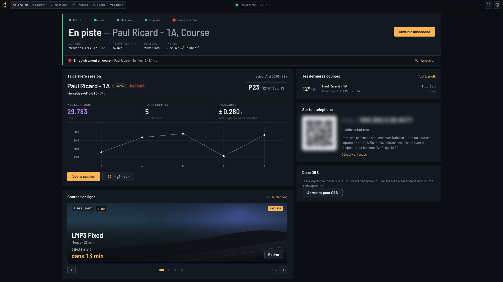

> **Version 1.4 (novembre 2026).** Nouveau : **Corde serveur s'installe sur un NAS Synology** (ou toute
> machine avec Docker), sans taper de commande ; et dans le **Studio**, tes tableaux de bord acceptent des
> photos, des logos et des vidéos, des couleurs qui changent selon la valeur et des éléments qui
> n'apparaissent qu'au bon moment. Corde fonctionne avec le jeu réel, mais elle est jeune : certaines parties n'ont pas encore été essayées en conditions réelles (le tableau
> [Où en est le projet](#où-en-est-le-projet) le dit ligne par ligne), et l'installeur n'est pas encore
> signé (voir [Installer](#installer-windows)). Les captures de cette page viennent du simulateur intégré.

## Sommaire

- [Installer (Windows)](#installer-windows)
- [Mettre à jour](#mettre-à-jour)
- [Désinstaller](#désinstaller)
- [Ce que fait Corde](#ce-que-fait-corde)
  - [Le tableau de bord en direct](#le-tableau-de-bord-en-direct)
  - [Sur le téléphone](#sur-le-téléphone)
  - [L'application iPhone](#lapplication-iphone)
  - [L'application Android](#lapplication-android)
  - [Sessions et tours](#sessions-et-tours)
  - [Profil et résultats de course](#profil-et-résultats-de-course)
  - [L'ingénieur de course](#lingénieur-de-course)
  - [Courses en ligne](#courses-en-ligne)
  - [Dans OBS](#dans-obs)
- [Corde serveur (Raspberry Pi ou NAS)](#corde-serveur-raspberry-pi-ou-nas)
- [Où en est le projet](#où-en-est-le-projet)
- [Pour les développeurs](#pour-les-développeurs)
- [Documentation](#documentation)
- [Sécurité et vie privée](#sécurité-et-vie-privée)
- [Licence](#licence)

## Installer (Windows)

1. Ouvre la page de la [dernière version](https://github.com/dultra123/corde/releases/latest) et télécharge
   `Corde_…_x64-setup.exe` (section *Assets*).
2. Lance-le. Windows affiche « Windows a protégé votre ordinateur » parce que l'installeur n'est pas signé :
   **Informations complémentaires**, puis **Exécuter quand même**. L'installation ne demande pas les droits
   administrateur.
3. Ouvre **Corde** depuis le menu Démarrer, puis lance Le Mans Ultimate (avec
   `Settings > Gameplay > Enable Plugins` activé). Corde détecte le jeu toute seule.

Le guide complet, avec le dépannage, est dans [docs/TESTING-ON-PC.md](docs/TESTING-ON-PC.md).

## Mettre à jour

Depuis la 0.6.0 : **Réglages → Mises à jour → Rechercher une mise à jour**, puis **Installer et
redémarrer** (jeu fermé). Corde télécharge la nouvelle version, vérifie sa signature, s'installe et
redémarre ; tes données sont conservées. Elle cherche aussi toute seule (au lancement puis toutes les
6 heures, désactivable) et te prévient, mais n'installe jamais rien sans ton clic. La 0.6.0 elle-même
s'installe à la main, par-dessus la version précédente. Les versions sont publiées sur la
[page des versions](https://github.com/dultra123/corde/releases) ; leurs nouveautés sont dans
[CHANGELOG.md](CHANGELOG.md). Détails : [docs/TESTING-ON-PC.md](docs/TESTING-ON-PC.md#9-mettre-à-jour).

## Désinstaller

1. Quitte Corde (clic droit sur son icône près de l'horloge → Quitter).
2. `Paramètres Windows` → `Applications` → `Applications installées` → **Corde** → `Désinstaller`. Le
   programme, le raccourci et le démarrage avec Windows sont retirés.
3. La désinstallation **garde tes données** (sessions, résultats importés, dispositions, réglages, journal).
   Pour tout effacer, supprime ensuite le dossier `%LOCALAPPDATA%\Corde` (tape `%LOCALAPPDATA%` dans la
   barre d'adresse de l'Explorateur). La case « Supprimer les données de l'application » du désinstalleur ne
   concerne que le cache d'affichage.

Les fichiers de réglage `Corde_*.svm` que tu as fait créer restent dans le dossier `Settings` du jeu, avec
tes autres réglages : supprime-les depuis le jeu ou l'Explorateur si tu n'en veux plus.

## Ce que fait Corde

### Le tableau de bord en direct

Le tableau de bord s'ouvre quand tu prends la piste. Dix widgets sont disponibles : tours et delta, commandes
(volant, pédales, régime), pneus (températures sur trois zones, pressions, usure), freins, carburant et
énergie, écarts, classement, carte du circuit, session et météo, électronique.

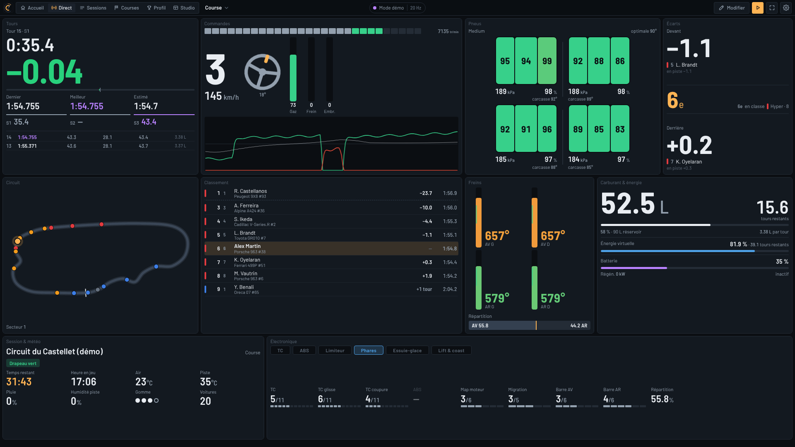

Chaque widget se déplace, s'étire et se supprime, et tu en ajoutes d'autres depuis la palette. Tu peux garder
plusieurs dispositions, par exemple une pour l'écran du PC et une pour le téléphone.

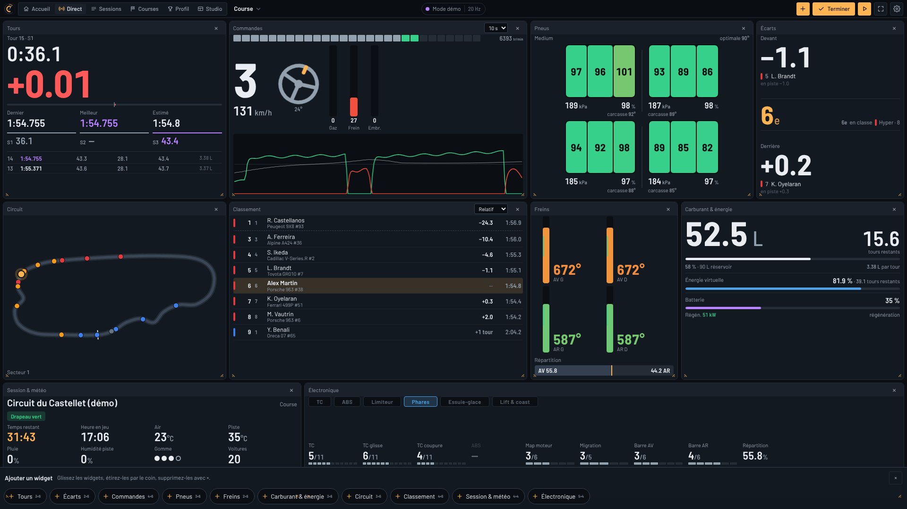

### Sur le téléphone

Les mêmes pages s'ouvrent dans le navigateur du téléphone, sur le même Wi-Fi que le PC. L'accès est fermé par
défaut ; il s'active d'un bouton sur l'écran d'accueil, qui propose alors un QR code à scanner. L'adresse
du PC et le QR code restent floutés tant qu'on ne demande pas à les voir, et le dossier de données est
affiché sans le nom du compte Windows : rien de personnel n'apparaît en direct ou sur une capture. Supprimer
une session, recalculer une analyse, réimporter les résultats, créer les fichiers de réglage et changer les
réglages restent réservés au PC ([pourquoi](docs/SECURITY-MODEL.md)).

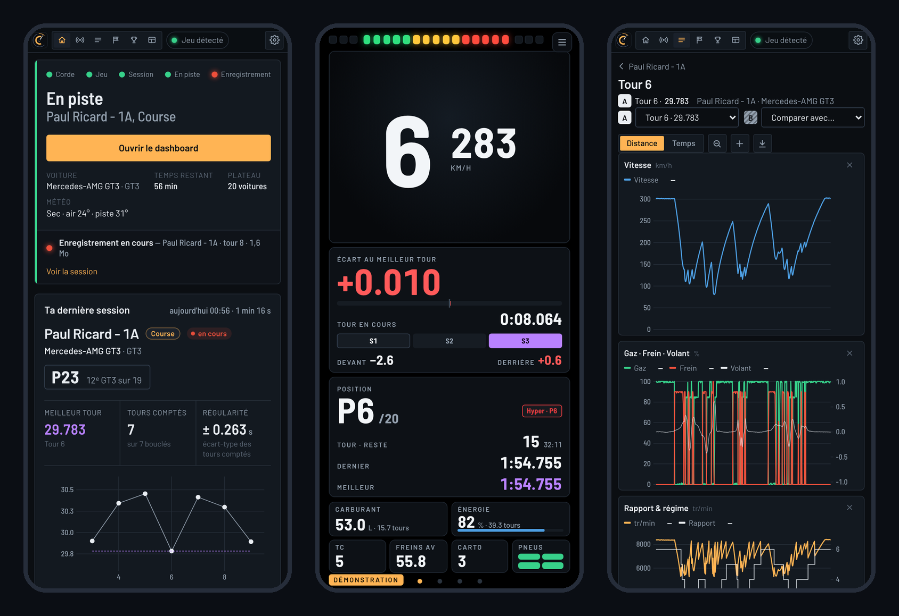

**Sur un téléphone, le Direct devient un vrai tableau de bord de course**, comme l'écran d'un volant de
course : plein écran, grand rapport au centre, rampe de régime qui clignote au passage, vitesse, écart au
meilleur tour, tours, carburant. Quatre pages se font glisser du doigt — **Course**, **Pneus & freins**,
**Carburant & énergie**, **Chronos & écarts** — et l'écran reste allumé tant qu'il est affiché. Pensé pour un
téléphone posé en paysage à côté du volant ; en portrait, les cases s'empilent. Ce que la voiture n'a pas
(pas d'ABS, pas d'énergie virtuelle…) ne s'affiche pas, et une donnée absente s'affiche « — ». Le bouton ☰
mène aux autres pages, aux réglages et à « Passer aux widgets ». **Sur le PC** (et une tablette), il se
choisit dans le menu des dispositions du Direct (groupe **Tableaux de bord**) et s'affiche dans la page,
sous la barre du haut ; un bouton **Plein écran** l'agrandit (Échap pour revenir), et une disposition de
widgets du même menu ramène la grille. Un second écran l'ouvre en plein écran à l'adresse **`…#/dash`**.

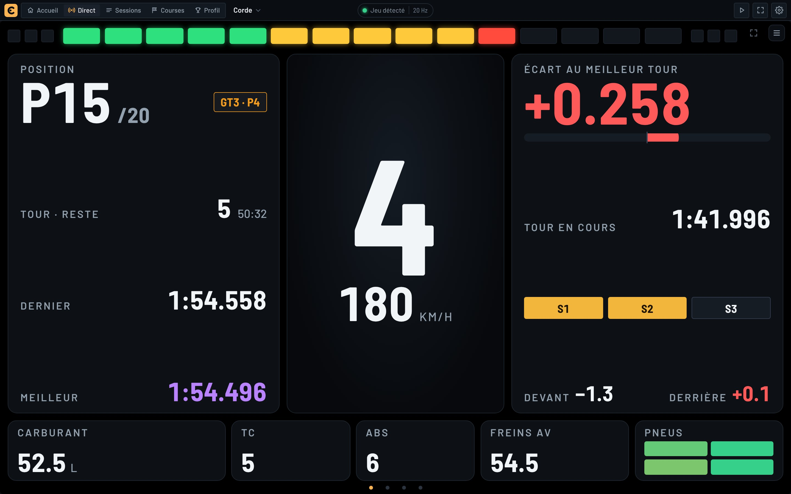

**Tes propres tableaux de bord (Studio)** : l'éditeur de tableaux de bord du PC — l'onglet **Studio** de la
barre du haut — place les données que tu veux sur une grille — valeurs, jauges, textes, blocs de Corde,
widgets — sur plusieurs pages, au format d'un téléphone, d'une tablette, d'un écran, d'un bandeau large, d'un
**petit écran rond de volant**, ou à la taille que tu veux ; la page peut être un rectangle, avoir des coins
arrondis ou être ronde. Glisser, redimensionner, annuler, aperçu avec une course de démonstration ; chaque
appareil choisit le sien. Depuis la 1.3 : **photos, logos et vidéos** choisis
sur ton PC (élément ou fond de page — la position GPS d'une photo est retirée avant l'envoi), **couleurs selon
la valeur** (seuils), **« Afficher quand… »** (limiteur, stands, drapeaux, une donnée sous un seuil), style
de chaque élément, police des chiffres, jauge circulaire, formes, bandeau d'alerte, rampe de régime réglable,
sélection multiple et copier / coller. Partage par fichier `.cordedash` (avec ses images). Pas à pas dans
[docs/TESTING-ON-PC.md](docs/TESTING-ON-PC.md#créer-ton-propre-tableau-de-bord-studio).

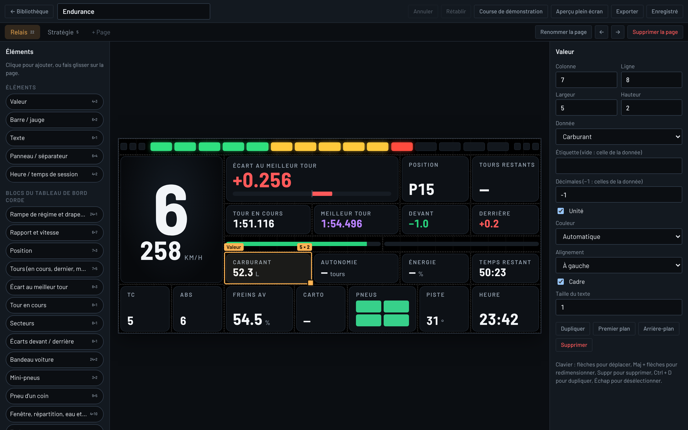

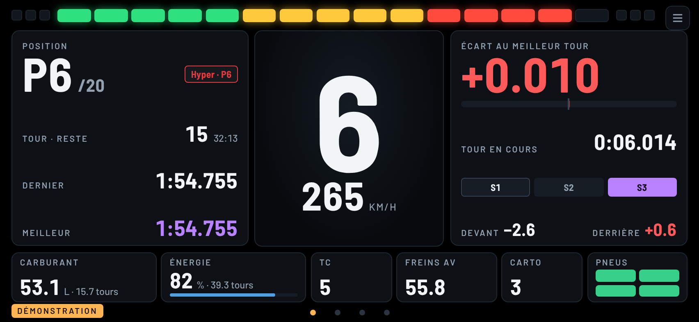

<p>
  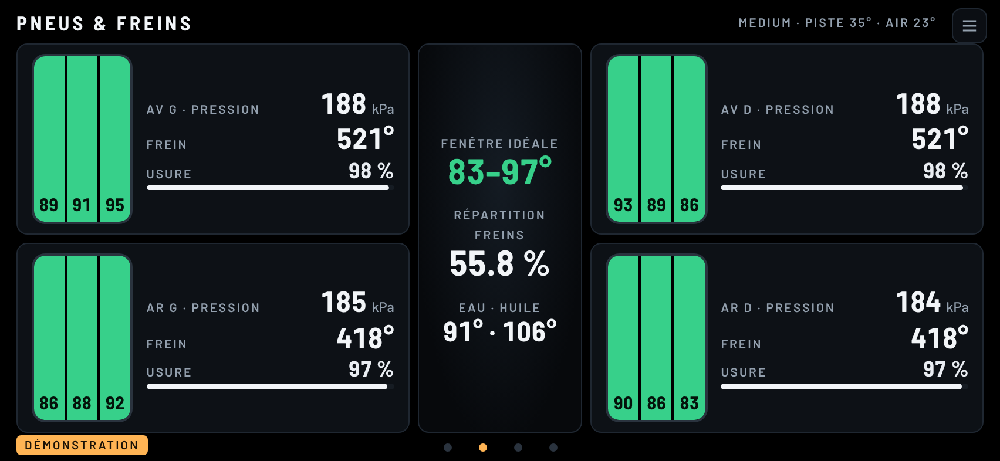
  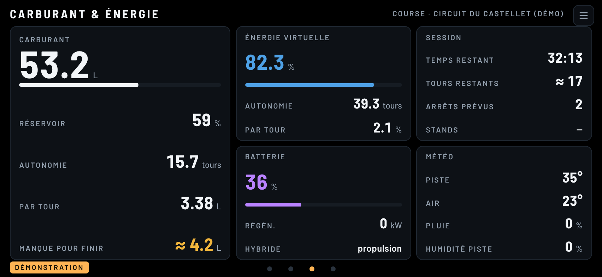
  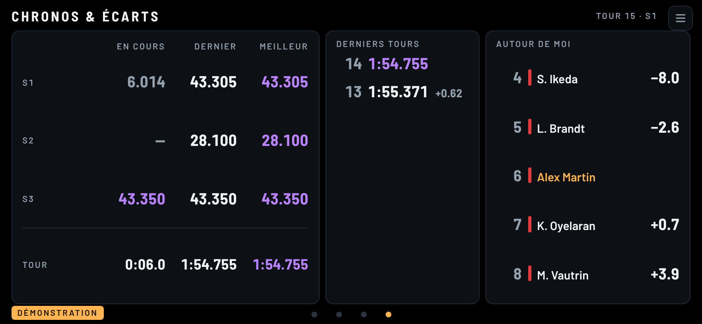
</p>

### L'application iPhone

La même interface dans une vraie application iPhone (en test par TestFlight, sur invitation ; pas encore
sur l'App Store) : onglets en bas de l'écran,
notifications, et surtout la page **Courses sans PC** — le téléphone lit lui-même le planning de
racecontrol.gg et lmu.tools, garde tes choix et **sonne les rappels même application fermée**. Le direct,
les sessions, l'ingénieur et le profil s'ouvrent dès qu'un PC ou un serveur Corde est ajouté dans
« Mes serveurs » (adresse ou QR code, appairage par code pour le serveur Corde). Depuis la 0.9 : des
**widgets** (prochaines courses, compte à rebours de tes départs, écran verrouillé) et le **compte à rebours
dans la Dynamic Island** ; depuis la 0.10, le widget **Courses en images** (une course par page, avec sa
photo et le SR / DR requis). Depuis la 1.1, le Direct est le **tableau de bord du téléphone** (ci-dessus), et
**« Voir une démonstration »** (dans « Mes serveurs ») le montre avec une course inventée, sans PC.
Compilée uniquement par GitHub (aucun Mac nécessaire) : [docs/IOS.md](docs/IOS.md).

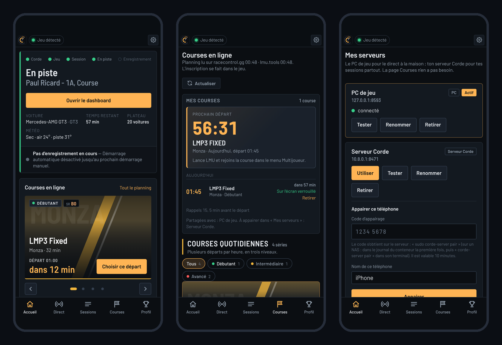

*Aperçu du mode application rendu dans Chromium à 390 px avec un faux pont Capacitor
(`packages/ui/scripts/screenshot-app.mjs`) — ce n'est pas une capture d'iPhone : sur le téléphone, la
page est affichée par WebKit, sous la barre d'état et au-dessus de la barre d'accueil de l'iPhone.*

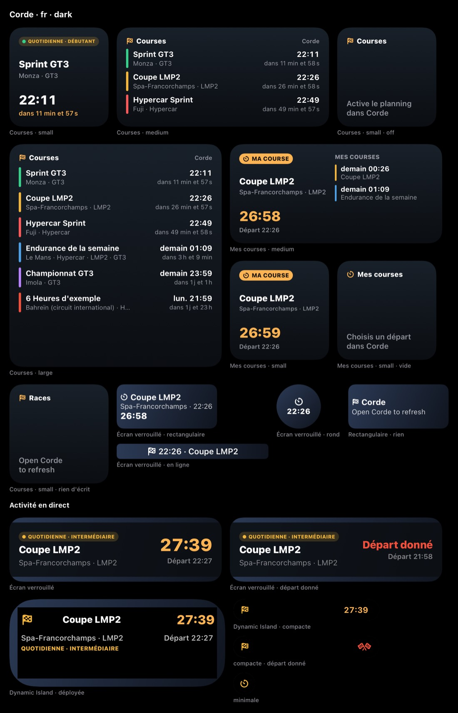

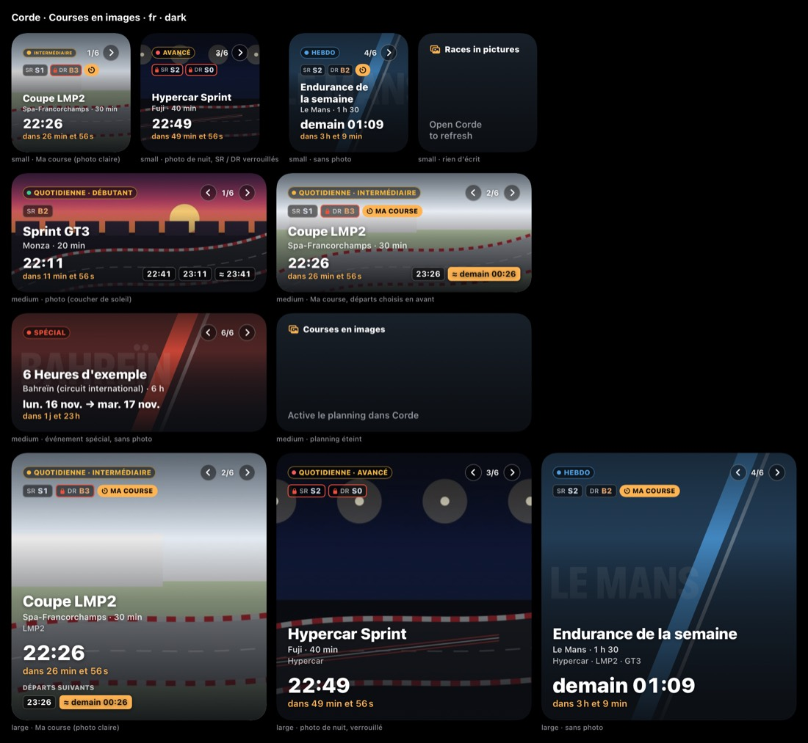

### L'application Android

La même application pour Android 8 ou plus récent, **sans aucune bibliothèque Google** (elle marche sur un
téléphone sans services Google) : courses sans PC, rappels en notifications à l'heure exacte même
application fermée, « Mes serveurs », le tableau de bord du téléphone (et sa démonstration sans PC),
sessions, ingénieur et profil. Pas encore de widgets ni de
compte à rebours. Elle s'installe à partir du fichier **`Corde_<version>_android.apk`** des
[releases](https://github.com/dultra123/corde/releases) (pas encore sur le Play Store). Compilée et essayée
sur un émulateur par GitHub, **pas encore essayée sur un vrai téléphone** : [docs/ANDROID.md](docs/ANDROID.md).

### Sessions et tours

Chaque session est enregistrée automatiquement. Les temps au tour sont ceux du jeu : un tour compte quand le
jeu l'a chronométré et qu'il ne passe pas par les stands.

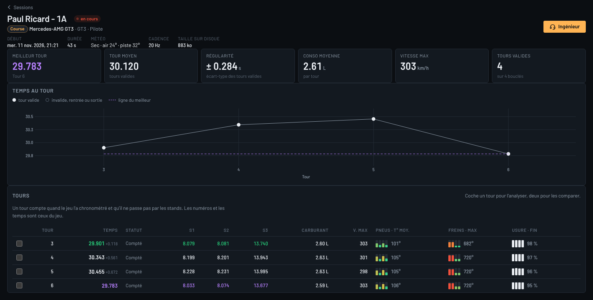

Tu peux ouvrir un tour, ou en comparer deux : écart de temps le long du tour, vitesse, gaz, frein, volant,
rapport et régime, accélérations, avec export CSV.

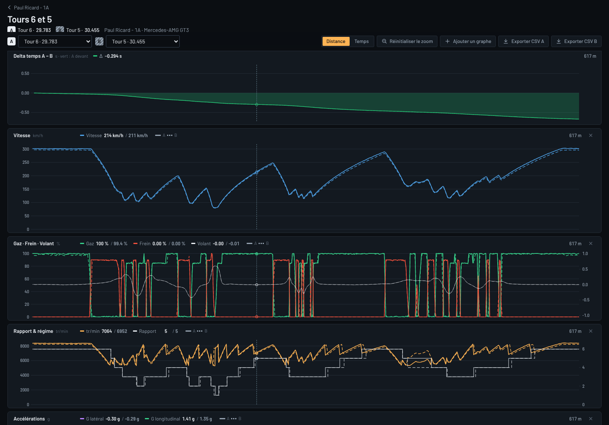

### Profil et résultats de course

Corde lit aussi les fichiers de résultats du jeu : classements, positions, incidents, et un profil qui
rassemble toutes tes courses par circuit et par voiture.

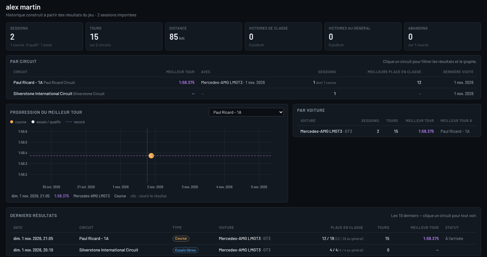

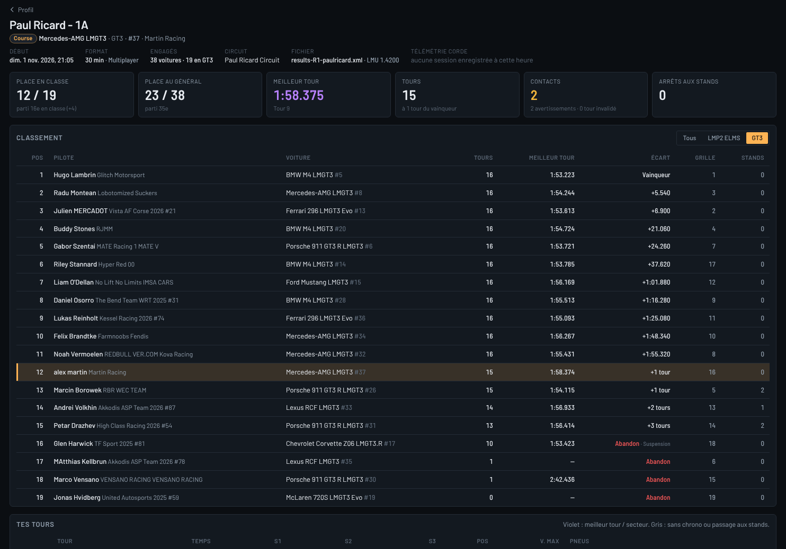

### L'ingénieur de course

Après une session d'au moins trois tours propres, l'ingénieur analyse tes données : régularité, style de
pilotage, températures et pressions des pneus, freins, équilibre de la voiture virage par virage, suspension.

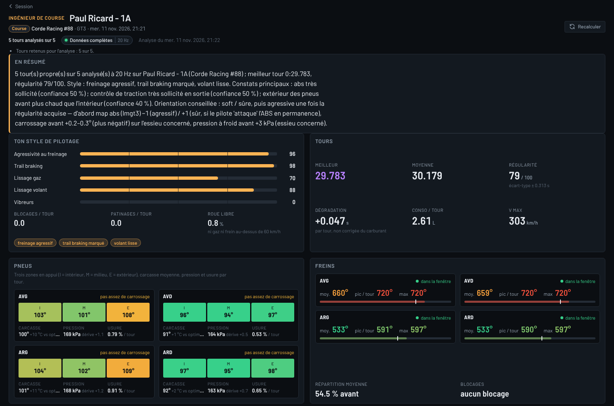

Il en tire des constats classés par gravité, chacun avec les chiffres qui le justifient.

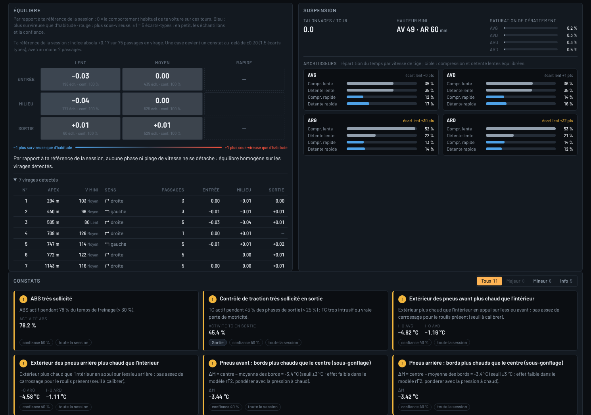

Il propose ensuite trois orientations de réglage — **agressif**, **soft et sûr**, **pluie** — sous forme de
changements ordonnés, avec la raison de chacun et ses effets secondaires.

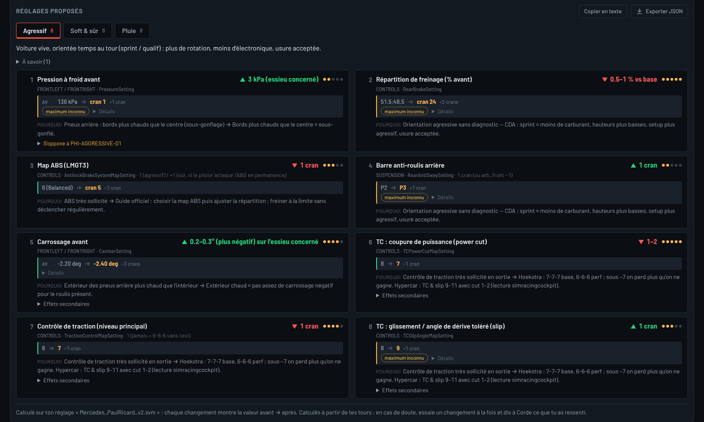

Tu en essaies un, puis tu écris ce que tu as ressenti, avec tes mots. Corde traduit ton ressenti en
symptômes, le compare aux données et propose deux ou trois petits changements pour l'étape suivante. Quand ton
ressenti et les données ne disent pas la même chose, elle te le signale.

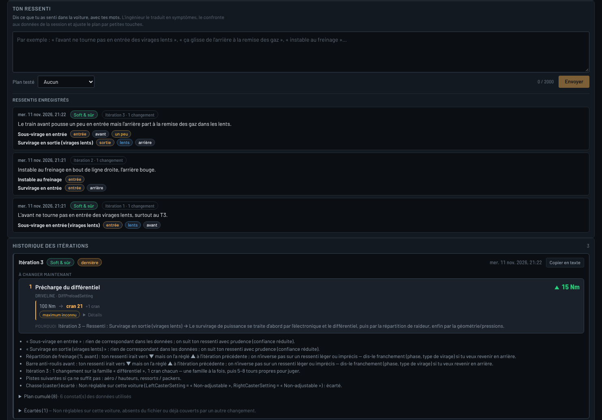

Corde lit tes propres fichiers de réglage (`.svm`, ceux que tu sauvegardes dans le garage du jeu), choisit
celui avec lequel tu as roulé et calcule chaque changement sur ce vrai réglage : valeur avant → après, en
crans du jeu, sans jamais proposer un réglage que ta voiture ne permet pas. D'un clic, elle écrit les fichiers
`Corde_…svm` à côté du tien ; dans le garage : Setups → rafraîchir → charger. Elle ne modifie ni n'écrase
jamais un fichier existant, et n'écrit rien d'autre dans le dossier du jeu.

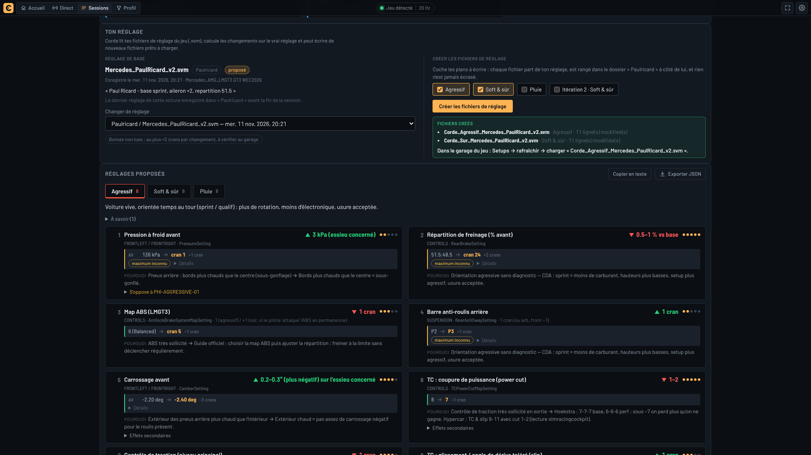

### Courses en ligne

L'onglet **Courses** montre le planning en ligne de Le Mans Ultimate : les courses quotidiennes (trois
niveaux, plusieurs départs par heure), les hebdomadaires, les événements spéciaux et les championnats
RaceControl Pro, avec leur circuit, leur durée, leurs catégories de voitures et les badges d'accès SR / DR
(marqués quand ton rang, que tu indiques, est en dessous). Touche un horaire : la course rejoint **Mes
courses**, avec un compte à rebours, et Corde te prévient avant le départ (15 et 5 min par défaut, au
choix entre 60 min et le départ) par un bandeau et un son court, sur le PC et sur le téléphone, quelle que
soit la page ouverte. Sur l'Accueil, sous ta dernière session, la carte **Courses en ligne** fait défiler
tes courses choisies puis les prochains départs, une course à la fois, avec l'image du site et le compte à
rebours. L'inscription, elle, se fait toujours dans le jeu : lance LMU et rejoins la course.

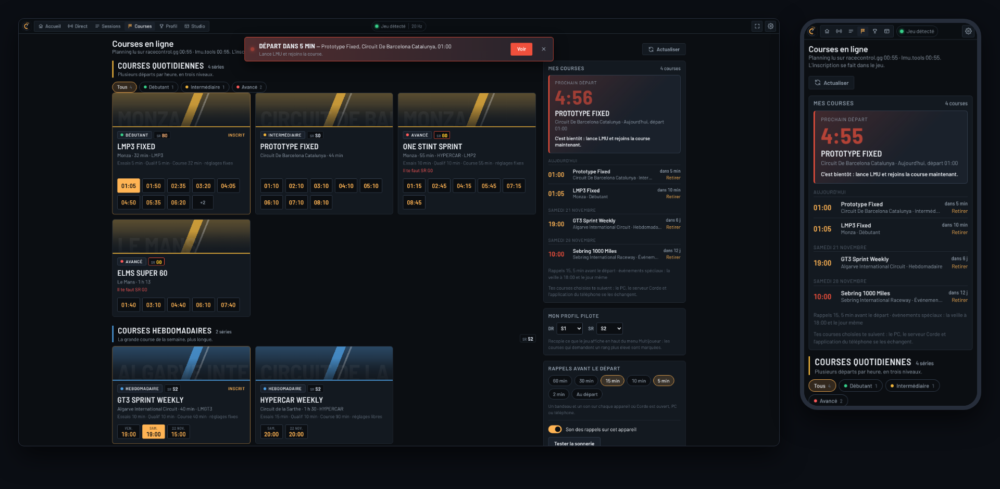

Le planning est **désactivé par défaut** : tant que tu ne l'actives pas (bouton de la page, sur le PC),
Corde ne contacte aucun site. Une fois activé, elle lit les pages publiques
[racecontrol.gg](https://racecontrol.gg/) (site officiel, courses quotidiennes) et
[lmu.tools](https://lmu.tools/schedule) (site communautaire, le reste), au plus toutes les 10 minutes,
sans compte ni identifiant ([vie privée](PRIVACY.md#planning-des-courses-en-ligne-optionnel-désactivé-par-défaut)).
Planning non officiel : si un site change sa page, Corde le dit et en garde une copie pour être adaptée.

### Dans OBS

Pour les streamers : chaque widget, ou une disposition entière, s'affiche **sur fond transparent par-dessus
le jeu** dans une source « Navigateur » d'OBS, sans rien de l'interface autour (ni barre, ni bandeau, ni
curseur). La page **OBS** de Corde (menu des dispositions du tableau de bord, ou carte « Dans OBS » de
l'Accueil) donne pour chacun un aperçu, l'adresse à copier et la taille conseillée de la source.

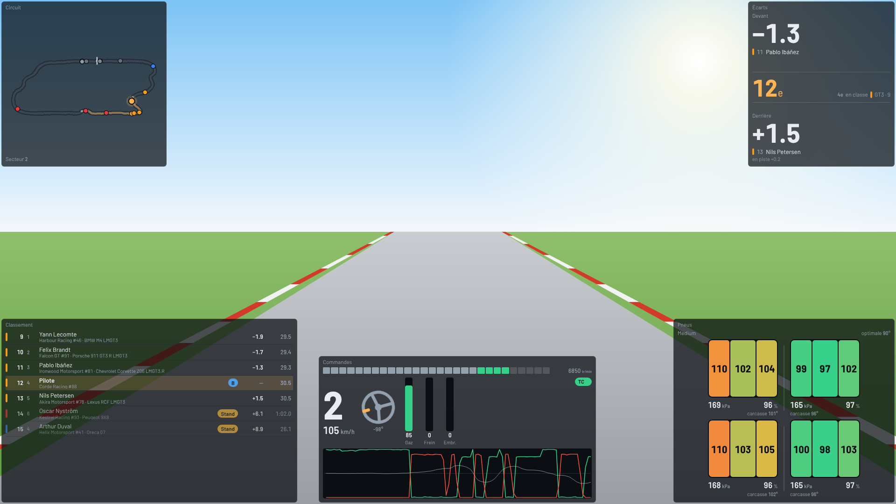

1. Dans OBS : **Sources → + → Navigateur**, puis OK.
2. Colle l'adresse copiée dans Corde, par exemple `http://127.0.0.1:8471/#/overlay/widget/inputs`.
3. Mets la **largeur et la hauteur conseillées** (640 × 384 pour les commandes, 1920 × 1080 pour une
   disposition), puis OK.

Options, à cocher dans la page OBS (elles complètent l'adresse) : fond des widgets `bg=none` (transparent,
avec un contour sombre pour rester lisible sur le jeu), `glass` (verre fumé, par défaut) ou `solid` ;
`opacity` ; `scale` (taille des textes) ; `hide=offtrack` (fondu quand tu n'es pas en piste) ; `lang=fr|en`.
Les **dispositions overlay** (canevas 1920 × 1080, sur damier) se composent dans le tableau de bord comme
les autres : menu des dispositions → « Nouvelle disposition overlay ». L'adresse proposée est celle du PC
lui-même (`127.0.0.1`), qui ne révèle rien à l'écran ; celle du réseau, pour un second PC de stream, n'est
montrée qu'à la demande. Pas à pas : [docs/TESTING-ON-PC.md](docs/TESTING-ON-PC.md#6-ter-dans-obs-streamers).

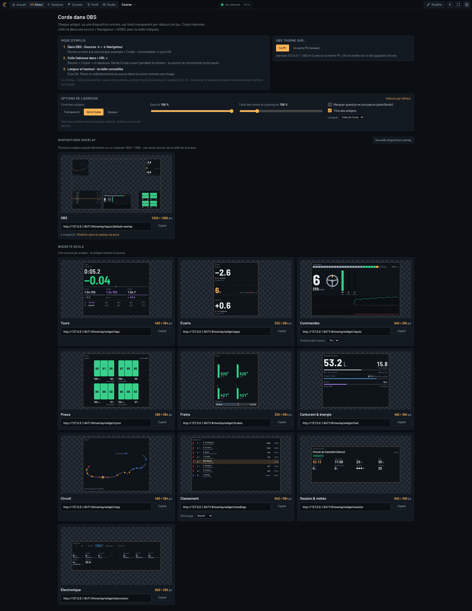

## Corde serveur (Raspberry Pi ou NAS)

Un petit serveur chez toi, toujours allumé (un **Raspberry Pi 5**, ou ton **NAS**), qui garde tes sessions,
l'ingénieur, ton profil et tes courses, et les montre à ton téléphone **PC éteint** — à la maison, ou dehors
à travers un **VPN que tu montes toi-même**. Le PC reste le seul à lire le jeu : il enregistre comme
d'habitude, puis envoie chaque session terminée au serveur (et, au démarrage, ce qui n'était pas encore
parti). Le direct reste sur le PC.

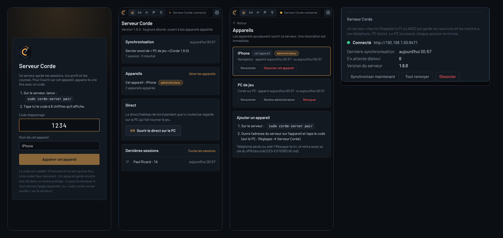

- **Seuls tes appareils** l'ouvrent : chacun est appairé une fois avec un code à 8 chiffres affiché sur le
  serveur lui-même (`sudo corde-server pair`), valable 10 minutes, une seule fois. Une révocation est
  immédiate (page **Appareils**).
- **Jamais sur Internet** : on n'ouvre pas le port de Corde sur la box ; dehors, on entre chez soi par un VPN.
- Installation : télécharge `corde-server-<version>-linux-arm64.tar.gz` (page des versions), puis
  `sudo ./install.sh` sur le Pi. Sur le PC : **Réglages → Serveur Corde**.

**Sur un NAS** (Synology avec Container Manager, ou tout Docker) au lieu d'un Pi : importe le fichier
`corde-server-<version>-docker-x64.tar.gz` (page des versions) dans Container Manager et crée le projet ; le
premier code d'appairage s'affiche dans le journal du conteneur, sans terminal :
[docs/SYNOLOGY.md](docs/SYNOLOGY.md).

Pas à pas pour un non-informaticien : [docs/SERVEUR.md](docs/SERVEUR.md) · accès depuis l'extérieur :
[docs/ACCES-EXTERIEUR.md](docs/ACCES-EXTERIEUR.md) · sécurité :
[docs/SECURITY-MODEL.md §7](docs/SECURITY-MODEL.md#7-le-serveur-corde-mode-hub).

## Où en est le projet

| Partie | État |
|---|---|
| Lecture de la télémétrie de Le Mans Ultimate (Windows) | fait, testé avec le jeu |
| Application Windows : écran d'accueil, tableau de bord, icône de zone de notification | fait, utilisée avec le jeu |
| Enregistrement des sessions, temps officiels du jeu, comparaison de tours | fait, testé avec le jeu |
| Profil et résultats de course | fait |
| Ingénieur : analyse, trois orientations de réglage, ressenti → ajustement | fait, à calibrer sur des données réelles |
| Fichiers de réglage `.svm` prêts à charger dans le jeu | fait (lecture de tes réglages, crans réels, écriture à la demande) ; bornes exactes à lire dans le garage du jeu sur ton PC |
| Page des courses en ligne (planning, mes courses, rappel sonore avant le départ) | fait ; lecture des vrais sites, son dans l'application Windows et rappels sur le téléphone à vérifier chez le pilote |
| Widgets dans OBS (fond transparent, page « OBS », dispositions overlay) | fait, vérifié dans Chromium ; à essayer dans une vraie source OBS |
| Mises à jour depuis l'application (releases numérotées signées) | fait ; confirmé par le propriétaire sur son PC (il n'installe plus que par le bouton, jusqu'à la 1.1.0) |
| Corde serveur (Raspberry Pi) : appairage, synchronisation depuis le PC, paquet Linux arm64 / x64 | fait (0.7.0), vérifié entre deux serveurs et sous émulation arm64 ; à installer sur un vrai Pi |
| Corde serveur sur un NAS (image de conteneur pour Synology Container Manager, x64 et arm64) | fait (non publié) ; image x64 essayée pour de vrai par la CI (durcissement, appairage, redémarrage, arrêt) ; **jamais installée sur un vrai NAS** ; arm64 construite, jamais essayée |
| Signature de l'installeur (plus d'avertissement Windows) | à décider |
| Application iPhone (Capacitor) : courses sans PC avec rappels en notifications, connexion au PC et au serveur Corde | fait ; installée par TestFlight sur l'iPhone du pilote (14 nov.), en test sur invitation ; pas encore sur l'App Store |
| Widgets iPhone (écran d'accueil, écran verrouillé) et compte à rebours dans la Dynamic Island | fait (0.9.0, iPhone seulement) ; fonctionnent sur l'iPhone du pilote (TestFlight) |
| Widget iPhone « Courses en images » (une course par page, photo, SR / DR requis) | fait (0.10.0, iPhone seulement) ; vu sur le simulateur de la CI, pas encore confirmé sur un iPhone |
| Application Android (Capacitor) : courses sans PC avec rappels en notifications, connexion au PC et au serveur Corde, sans services Google | fait (lot 1, sans widgets) ; compilée et essayée sur un émulateur Android 15 sans services Google par la CI (démarrage, lien, rappel reçu application tuée et téléphone en veille) ; **jamais vue sur un vrai téléphone** ; APK signé publié quand la clé de signature est fournie |
| Tableau de bord du téléphone (Direct plein écran, quatre pages, écran allumé, démonstration dans l'application) | fait (1.1.0) ; vérifié avec la course de démonstration dans Chromium (cinq tailles d'écran) et sur le simulateur iOS / l'émulateur Android de la CI ; **pas encore vu avec le jeu ni sur un vrai téléphone** |
| Linux (le jeu tourne sous Proton) | serveur compilé, non testé avec le jeu |
| Autres simulateurs (ACC, Assetto Corsa EVO, iRacing, rFactor 2…) | à venir |

Le détail, tenu à jour à chaque étape, est dans [docs/STATUS.md](docs/STATUS.md).

## Pour les développeurs

Corde est un monorepo : un cœur en Rust (acquisition, enregistrement, analyse, serveur local) et une interface
web en React / TypeScript, emballés en application de bureau avec Tauri 2.

### Prérequis

- **Rust** stable ≥ 1.89 (`rustup`, composants `rustfmt` et `clippy` via `rust-toolchain.toml`)
- **Node 22** et **pnpm 10** (`corepack enable` suffit : `packageManager` est déclaré dans `package.json`)
- Pour tester avec le vrai jeu : Le Mans Ultimate ≥ 1.2 avec `Settings > Gameplay > Enable Plugins` activé
  (Windows) ; sous Linux, un pont Proton tel que [winecarte](https://github.com/srounce/winecarte)
  (voir [ADR 0004](docs/adr/0004-linux-pont-proton.md))

### Démarrage rapide

```bash
# 1. Types TypeScript générés depuis le protocole Rust (à refaire après tout changement de corde-protocol)
cargo test -p corde-protocol          # alias : pnpm protocol:gen

# 2. Serveur local alimenté par le simulateur intégré (pas besoin du jeu)
#    --dev-origins : accepte l'interface servie par `vite dev` sur un autre port (étape 3).
#    Développement seulement : sans cette option, seule l'interface que le serveur sert
#    lui-même peut l'appeler depuis un navigateur (docs/SECURITY-MODEL.md §3).
cargo run -p corde-server -- --source sim --dev-origins
#    → http://127.0.0.1:8471  (WebSocket sur /ws)

# 3. Dashboard en mode développement (rechargement à chaud, proxy /ws et /api vers le serveur)
pnpm install
pnpm --filter @corde/ui dev
#    → http://localhost:5173   (ajouter ?demo=1 pour une course fictive sans serveur)
```

Vérifications avant de pousser :

```bash
cargo fmt --all --check && cargo clippy --workspace --all-targets && cargo test --workspace
pnpm -r typecheck && pnpm -r test && pnpm -r build
```

Avec le vrai jeu sur Windows : lancer `lmu-probe.exe` (diagnostic ; `--once --dump frame.json` écrit une trame complète) puis
`corde-server.exe`. Guide complet pour le client : [docs/TESTING-ON-PC.md](docs/TESTING-ON-PC.md).

### Structure du dépôt

```
corde/
├─ Cargo.toml                 # workspace Rust
├─ crates/
│  ├─ corde-protocol/         # types partagés (serde + ts-rs) — LE contrat
│  ├─ corde-core/             # trait TelemetrySource, AutoSource (le jeu qui tourne), LapTracker, derive::*
│  ├─ corde-lmu/              # adaptateur Le Mans Ultimate (+ outils lmu-probe, lmu-shm-fake)
│  ├─ corde-acc/              # adaptateur Assetto Corsa Competizione et Assetto Corsa, expérimental (+ outil acc-probe)
│  ├─ corde-sim/              # simulateur LMU_Data pour développer sans le jeu
│  ├─ corde-store/            # enregistrement des sessions : SQLite + Parquet (+ CLI corde-store)
│  ├─ corde-engineer/         # ingénieur de course : analyse d'une session → rapport + 3 orientations
│  └─ corde-server/           # exécutable serveur (axum : HTTP, WebSocket, UI statique)
├─ packages/
│  ├─ protocol/               # @corde/protocol : types TS générés + constantes
│  └─ ui/                     # @corde/ui : interface React (accueil, dashboard, sessions, courses, ingénieur)
├─ apps/
│  ├─ desktop/                # application Windows (Tauri 2) + installeur, workspace Cargo à part
│  └─ mobile/                 # applications iPhone (ios/, Swift Package Manager) et Android (android/, Gradle) — Capacitor 8, compilées par la CI
├─ docs/                      # SPEC, ARCHITECTURE, ADR, guides, research/
├─ knowledge/                 # base de connaissances « ingénieur » (YAML + méthodologie)
├─ reference/                 # layout mémoire calculé, échantillons de résultats (noms remplacés)
└─ .github/workflows/         # CI Linux + Windows, installeur, version continue ; ios.yml (simulateur, TestFlight) ; android.yml (émulateur, APK signé)
```

## Documentation

- [docs/PRESENTATION.md](docs/PRESENTATION.md) — fiche de présentation à jour : ce que fait Corde, où elle
  tourne, nouveautés, ce qui arrive, images et liens (pour un site ou une annonce)
- [docs/SPEC.md](docs/SPEC.md) — cahier des charges : vision, personas, parcours, fonctionnalités par phase,
  widgets, fonctionnement de l'ingénieur, contraintes, questions ouvertes
- [docs/ARCHITECTURE.md](docs/ARCHITECTURE.md) — architecture, flux de données, conventions, ports et chemins
- [docs/adr/](docs/adr/) — décisions : [stack](docs/adr/0001-stack.md),
  [protocole](docs/adr/0002-protocole-normalise.md),
  [mémoire partagée native](docs/adr/0003-memoire-partagee-native-vs-plugin.md),
  [Linux / Proton](docs/adr/0004-linux-pont-proton.md),
  [licences](docs/adr/0005-licences-et-header-s397.md),
  [stockage local-first](docs/adr/0006-stockage-local-first.md),
  [signature Windows](docs/adr/0007-windows-smartscreen-signature.md),
  [passage en open source](docs/adr/0008-open-source-publication.md),
  [mises à jour signées](docs/adr/0009-mises-a-jour-releases-github-signees.md),
  [serveur domestique](docs/adr/0010-serveur-domestique.md),
  [application iPhone](docs/adr/0011-application-mobile-capacitor.md),
  [widgets iOS et activité en direct](docs/adr/0012-widgets-activite-en-direct.md),
  [application Android](docs/adr/0013-application-android.md),
  [tableau de bord du téléphone](docs/adr/0014-tableau-de-bord-telephone.md),
  [Corde serveur en conteneur](docs/adr/0017-corde-serveur-en-conteneur.md)
- [docs/TESTING-ON-PC.md](docs/TESTING-ON-PC.md) — installer et utiliser Corde sur Windows, dépannage
- [docs/SERVEUR.md](docs/SERVEUR.md) — installer Corde serveur sur un Raspberry Pi, appairer, sauvegarder
- [docs/SYNOLOGY.md](docs/SYNOLOGY.md) — installer Corde serveur sur un NAS Synology (Container Manager), sans commande
- [docs/ACCES-EXTERIEUR.md](docs/ACCES-EXTERIEUR.md) — ouvrir le serveur depuis l'extérieur par un VPN, sans exposer Corde
- [docs/IOS.md](docs/IOS.md) — l'application iPhone : ce qu'elle fait, comment sortent les versions (CI, TestFlight), ce qu'il faut faire côté Apple
- [docs/ANDROID.md](docs/ANDROID.md) — l'application Android : l'installer (APK), ses autorisations, quoi essayer, la clé de signature et la CI
- [docs/STATUS.md](docs/STATUS.md) — état détaillé du projet, tenu à jour à chaque étape
- [CHANGELOG.md](CHANGELOG.md) — nouveautés de chaque version (affichées par l'application avant une mise à jour)
- [docs/ENGINEER.md](docs/ENGINEER.md) — comment l'ingénieur analyse une session et ajuste un réglage
- [docs/CONTRIBUTING.md](docs/CONTRIBUTING.md) — conventions, commits, types générés, ajouter un jeu
- [docs/research/](docs/research/) — briefs : télémétrie LMU, ingénieur de course, stack technique
- [knowledge/README.md](knowledge/README.md) — schémas des fichiers de connaissances et niveaux de confiance

## Sécurité et vie privée

- **Vie privée** : tout reste sur ton PC — pas de compte, pas de télémétrie, rien n'est envoyé sur Internet
  sauf si tu actives l'extracteur LLM optionnel ; le planning des courses en ligne, s'il est activé, lit
  deux pages publiques sans rien y envoyer de toi ; la recherche de mises à jour (désactivable) lit un
  fichier public sur GitHub, qui voit ton adresse IP. Les applications iPhone et Android gardent tout sur
  le téléphone et ne parlent qu'aux serveurs Corde que tu ajoutes (et, si tu l'actives, aux deux pages du
  planning) ; l'application Android n'a aucune bibliothèque Google et ses données ne partent pas dans les
  sauvegardes.
  Détails : [PRIVACY.md](PRIVACY.md).
- **Sécurité** : le serveur local n'écoute que sur ton PC par défaut ; ce qui est exposé quand l'accès
  depuis le téléphone est activé est décrit dans [docs/SECURITY-MODEL.md](docs/SECURITY-MODEL.md). Corde
  serveur exige un appareil appairé pour tout, et ne doit jamais être ouvert sur Internet (§7).
- **Signaler une faille** : en privé, par l'onglet *Security* du dépôt → *Report a vulnerability*
  ([SECURITY.md](SECURITY.md)). Pas de ticket public.

## Licence

Corde est un **logiciel libre**, publié sous la licence **GNU General Public License, version 3 ou toute
version ultérieure** (GPL-3.0-or-later) : tu peux l'utiliser, l'étudier, le modifier et le redistribuer, à
condition que toute version distribuée, modifiée ou non, reste sous la même licence avec son code source. Le
texte complet est dans [LICENSE](LICENSE) ; les raisons du choix et le plan de publication, dans
l'[ADR 0008](docs/adr/0008-open-source-publication.md).

Copyright (C) 2026 dultra__ et les contributeurs.

Les polices Barlow, Barlow Semi Condensed, Share Tech Mono et Orbitron, livrées avec l'interface (aucune
n'est téléchargée), sont sous licence SIL Open Font License 1.1 (OFL-1.1). Les dépendances Rust et web gardent leurs propres licences, toutes compatibles
([ADR 0005](docs/adr/0005-licences-et-header-s397.md), [ADR 0008](docs/adr/0008-open-source-publication.md)).

Corde n'est pas affiliée à Studio 397 ni à Motorsport Games. « Le Mans Ultimate » est une marque de ses
ayants droit.
