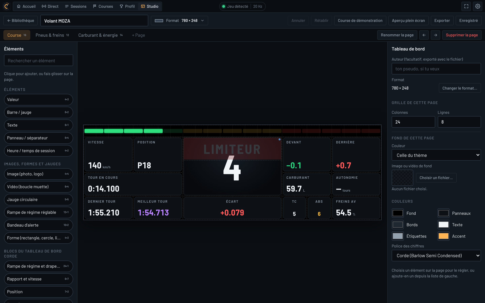
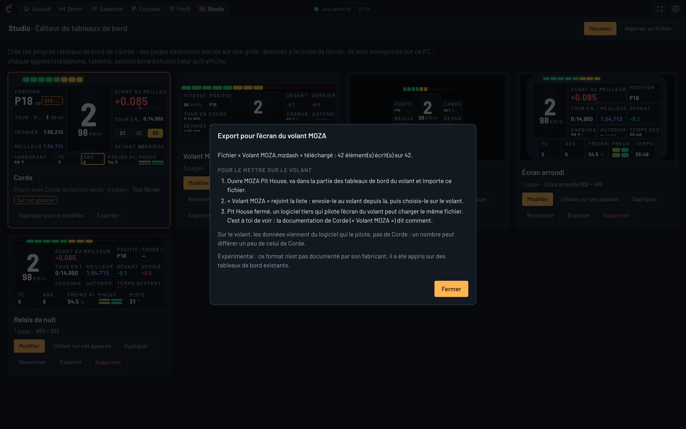

# Un tableau de bord de Corde sur l'écran d'un volant MOZA

> **Expérimental.** Corde sait écrire un tableau de bord au format des volants MOZA à écran (KS Pro,
> CS Pro : 780 × 248). Ce format n'est pas documenté par son fabricant : il a été appris sur des tableaux
> de bord existants, et **aucun export n'a encore été vu sur un volant**. Si tu l'essaies, dis ce que ça
> donne (voir [Dire ce que ça donne](#dire-ce-que-ça-donne)).

## Ce que ça fait, et ce que ça ne fait pas

- Tu dessines un tableau de bord dans le **Studio** de Corde, tu cliques **Exporter pour le volant
  MOZA**, tu obtiens un fichier `<Nom>.mzdash`. Ce fichier se charge sur le volant comme n'importe quel
  tableau de bord MOZA.
- **Corde ne parle pas au volant.** Elle n'envoie rien à la base, n'ouvre aucun port, n'écrit dans aucun
  dossier de Pit House. Elle fabrique un fichier, c'est tout.
- **Sur le volant, les données viennent du logiciel qui le pilote** (MOZA Pit House, ou un autre), pas
  de Corde. Un nombre peut donc différer un peu de celui que Corde affiche sur ton téléphone.
- Tu peux garder **Pit House ouvert** : c'est la voie normale. Une autre voie, Pit House fermé, existe
  avec un logiciel tiers ; elle est décrite plus bas, et c'est toi qui choisis.

Le pourquoi de tout ça : [ADR 0021](adr/0021-ecran-du-volant-moza.md).

## 1. Créer le tableau de bord

1. Ouvre Corde sur le PC, onglet **Studio**.
2. Clique **Nouveau**.
3. Sous **Modèle de départ**, coche **Écran de volant MOZA (KS Pro, CS Pro)**. Le format **Écran de
   volant MOZA**, 780 × 248, se choisit tout seul.
4. Clique **Créer · 780 × 248**.



Tu obtiens trois pages : **Course**, **Pneus & freins**, **Carburant & énergie**. Tout ce qui s'y trouve
s'exporte. Change ce que tu veux : déplace, supprime, ajoute des éléments depuis la colonne de gauche.

Tu pars d'un tableau de bord que tu as déjà ? Ouvre-le, clique **Format** en haut, choisis **Écran de
volant MOZA**. Le bouton d'export n'apparaît que pour un tableau de bord à ce format.

## 2. Ce qui s'exporte

| Élément du Studio | Sur le volant |
| --- | --- |
| **Valeur** | oui : le nombre, son étiquette, son cadre, ses couleurs |
| **Barre / jauge** | oui, horizontale ou verticale |
| **Texte**, **Panneau / séparateur**, **Forme** | oui |
| **Rampe de régime réglable** | oui, voyant par voyant |
| **Bandeau d'alerte** | oui, clignotant si tu l'as demandé |
| **Heure / temps de session** | seulement **Temps restant** |
| **Jauge circulaire** | la valeur seule, sans l'arc |
| « Afficher seulement quand… », règles de couleur, fond et contour d'un élément | oui |
| **Rampe de régime et drapeaux**, **Rapport et vitesse**, **Écart au meilleur tour**, **Position**, **Tour en cours** | sous une forme plus simple |
| Les autres blocs de Corde, les pages entières, les widgets | non |
| **Image**, **Vidéo**, image de fond d'une page | non (pas encore) |

Et pour les **données** : le volant ne reçoit pas tout ce que Corde connaît. S'exportent : vitesse,
rapport, régime, limiteur, température d'eau, accélérateur, frein, embrayage, tours (en cours, dernier,
meilleur, estimé), écart au meilleur, numéro de tour, avancement dans le tour, position, nombre de
voitures, écarts devant et derrière, temps restant, nom du circuit, carburant (litres, niveau, par tour,
autonomie), énergie virtuelle, batterie, antipatinage, ABS, cartographie moteur, répartition de
freinage, températures de piste et d'air, et par roue : température du pneu, pression, température du
frein.

**Ne s'exportent pas** : huile, angle du volant, forces g, position de classe, écart au premier, arrêts
(effectués, prévus), tours restants, temps écoulé, carburant pour finir, énergie par tour et autonomie
en énergie, régénération, pluie, piste mouillée, temps de secteur, **usure des pneus**, heure en jeu,
secteur en cours, migration de freinage.
Les quatre dernières existent côté volant, mais sans qu'on sache encore exactement ce qu'elles
valent : Corde préfère une case absente à un nombre faux.

Rien n'est laissé de côté en silence : après l'export, Corde affiche la liste de ce qu'elle n'a pas
écrit, et pourquoi.

## 3. Exporter

1. Dans le **Studio**, reviens à la bibliothèque (bouton **← Bibliothèque** si tu es dans l'éditeur).
2. Sur la carte de ton tableau de bord, clique **Exporter pour le volant MOZA**.
3. Le fichier `<Nom>.mzdash` arrive dans ton dossier **Téléchargements**. Une fenêtre dit combien
   d'éléments ont été écrits, et liste sous **À savoir** ceux qui ne l'ont pas été.



Le nom du fichier ne garde que des lettres sans accent, des chiffres, des espaces, `-` et `_` : c'est de
lui que le volant tire le nom qu'il affiche.

## 4. Le mettre sur le volant, avec MOZA Pit House

Pit House reste ton logiciel pour régler la base : rien ne change de ce côté.

**Par l'import de Pit House** — le plus simple :

1. Ouvre **MOZA Pit House**, volant branché.
2. Va dans la partie des **tableaux de bord** du volant.
3. Utilise son **import** et choisis le fichier `<Nom>.mzdash` dans **Téléchargements**.
4. Le tableau de bord rejoint la liste : **envoie-le au volant**, puis choisis-le sur le volant comme
   les autres.

**Par le dossier**, si l'import ne le prend pas :

1. Dans l'Explorateur de fichiers, clique dans la barre d'adresse, colle ceci et valide par Entrée :

   ```text
   %LOCALAPPDATA%\MOZA Pit House\_dashes\dashes
   ```

   Tu y vois un dossier par tableau de bord déjà fait avec l'éditeur de MOZA.
2. Crée un dossier **du même nom que le fichier, sans `.mzdash`** (pour `Volant MOZA.mzdash` : un
   dossier `Volant MOZA`).
3. Mets le fichier dedans.
4. Ferme Pit House s'il était ouvert, rouvre-le, ouvre l'éditeur de tableaux de bord (**MOZA Dash
   Studio**) : ton tableau de bord est dans la liste. Ouvre-le, regarde s'il ressemble à ce que tu as
   dessiné, puis **Upload Dashboard** pour l'envoyer au volant.

Ce passage par l'éditeur de MOZA est aussi le bon moyen de **retoucher** : une police trop grande, une
case à décaler de quelques points se corrigent là en deux clics.

## 5. Sans Pit House : la voie d'un logiciel tiers

L'écran du volant ne se pilote par autre chose que **Pit House complètement fermé** (pas seulement
réduit) : les deux se disputent la même liaison avec la base. Si tu roules déjà comme ça, le même
fichier `.mzdash` peut être envoyé au volant par **SimHub** avec le greffon libre **AZOM**
(<https://github.com/giantorth/AZOM>), qui sait téléverser un `.mzdash` et alimenter l'écran, chaque
donnée étant réglable.

À savoir avant de t'y lancer :

- **Ce n'est pas Corde.** Ni SimHub ni ce greffon ne sont faits, livrés ou vérifiés par Corde. Leur
  installation et leur usage sont décrits par leurs auteurs ; suis leur guide, pas celui-ci.
- **C'est ce logiciel-là qui parle à ta base**, à la place de Pit House. Tant qu'il tourne, tu ne
  règles plus la base depuis Pit House.
- **Corde ne l'a pas essayé** sur un volant. À toi de voir.

Dans les grandes lignes : Pit House fermé, SimHub ouvert avec le greffon, la page du volant a un onglet
de fichiers d'où l'on envoie un `.mzdash` choisi sur le PC ; un autre onglet relie chaque donnée du
tableau de bord à une donnée de SimHub.

## 6. Deux volants

Un fichier exporté vaut pour un écran de 780 × 248 : KS Pro et CS Pro. Charge-le sur chacun des volants
qui en a un. Un volant sans écran n'est pas concerné : pour lui, le tableau de bord de Corde reste sur
le téléphone ou la tablette.

## Si ça ne marche pas

| Ce que tu vois | Ce que ça veut dire | Quoi faire |
| --- | --- | --- |
| Pas de bouton **Exporter pour le volant MOZA** | Le tableau de bord n'est pas au format du volant | Éditeur → **Format** → **Écran de volant MOZA** |
| La fenêtre dit « 0 élément(s) écrit(s) » | Le tableau de bord n'est fait que de blocs de Corde ou de widgets | Pars du modèle **Écran de volant MOZA**, ou remplace les blocs par des **Valeur** et des **Barre** |
| Pit House refuse le fichier, ou ne montre rien | Le format appris n'est pas tout à fait le bon | Essaie la voie du dossier ; garde le fichier et dis-le (ci-dessous) |
| Des `-` partout sur le volant | Aucune donnée n'arrive : jeu fermé, ou jeu que Pit House ne lit pas | Lance le jeu ; vérifie dans Pit House que le jeu est reconnu |
| Une case reste sur `-` en roulant | Ce jeu ne donne pas cette donnée à Pit House | Retire la case, ou dis-le |
| Un nombre déborde de sa case | La police du volant est plus large que prévu | Agrandis la case dans le Studio, ou retouche dans l'éditeur de MOZA |
| Un nombre semble faux (unité, pourcentage) | Une donnée n'a pas le sens que Corde lui a prêté | Dis-le : c'est exactement ce qu'il faut savoir |

## Dire ce que ça donne

Ouvre un ticket sur <https://github.com/dultra123/corde/issues> avec :

- le volant (KS Pro, CS Pro) et la base ;
- la voie utilisée (import de Pit House, dossier, logiciel tiers) ;
- le jeu ;
- une photo de l'écran du volant et, à côté, une capture du même tableau de bord dans le Studio ;
- le fichier `.mzdash` exporté.

Le fichier ne contient rien de toi : ni nom, ni chemin, ni identifiant de ton matériel — seulement la
disposition, des couleurs et les textes que tu as tapés.
